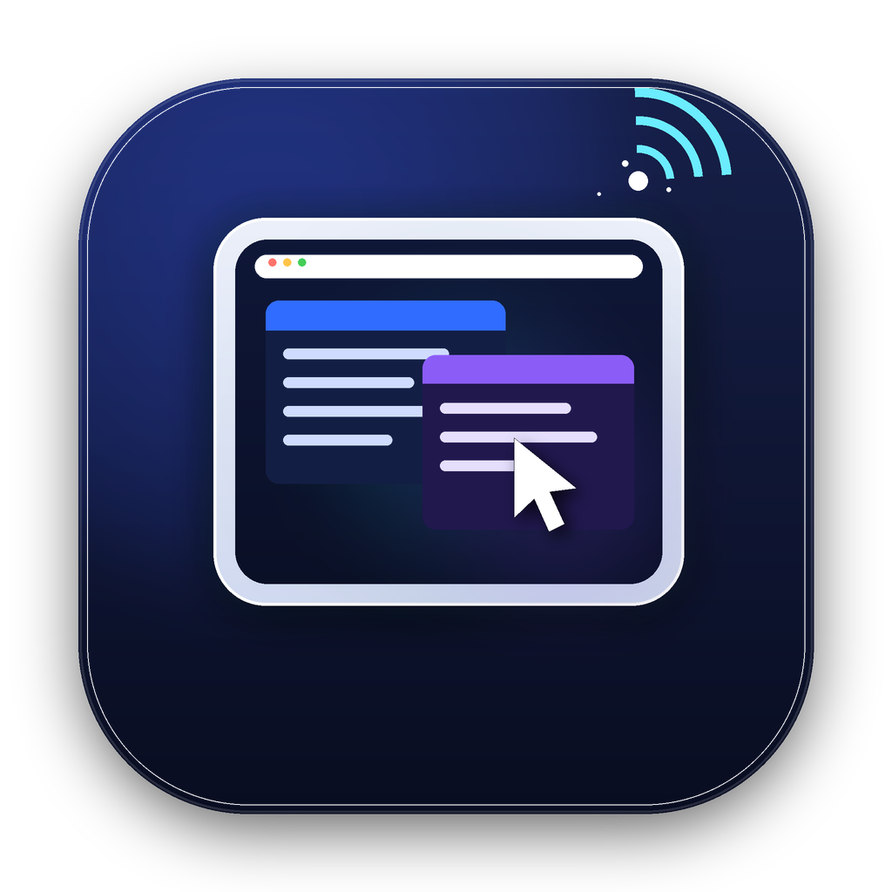

<p align="center">
  
</p>

<h1 align="center">Tablet Display</h1>

<p align="center">把 Android 平板变成 Mac 的无线扩展屏。</p>

Tablet Display 在 Mac 上创建一块虚拟显示器，用 ScreenCaptureKit 采集、VideoToolbox 硬件编码 H.264，通过 Wi-Fi 传给平板；平板用 MediaCodec 硬解全屏显示，并把单点触摸回传成 Mac 鼠标操作。

当前版本 **0.2.0**，测试设备为华为 WGR-W09（Android 12，2560×1600，60Hz）。

## 功能

- 无线扩展屏：首次用 USB 切换无线 ADB，之后不需要数据线。
- 60fps：采集/编码/解码/呈现全链路约 58–60fps。
- 硬件编解码：VideoToolbox H.264 + MediaCodec 硬解。
- 单点触摸：按视频实际显示区域映射，支持黑边。
- 横屏锁定、断线重连、采集自动重启。
- token 鉴权 + 平板 IP 白名单。
- 菜单栏应用、自定义图标、桌面启动器。
- 启动控制面板：实时状态、分辨率/帧率/码率设置、启动显示/关闭退出开关、保存并重启、权限/日志/状态页/退出。
- 网络变化恢复：显示本机/平板 IP，支持手动输入平板新 IP 重连；启动时找不到平板不再直接退出。
- ADB 恢复：连接失败自动重启 adb server，并尝试 `adb mdns services` 发现的无线调试 endpoint。
- 低延迟：手动重连优先直连；Android 使用 Wi-Fi 低延迟锁；H.264 使用长 GOP + 按需强制关键帧，减少周期性码率突发。
- UDP-RTP 视频：直连模式优先走 UDP（默认 9138），避免 TCP 队头阻塞；UDP 不可用时自动回退 TCP `/video`；丢包时请求新 IDR。
- Android 自适应启动图标，与 macOS 图标使用同一套视觉。
- 版本化 `.app`、DMG 打包、notarize 脚本。

## 环境要求

- macOS 13 或更新版本（当前在 macOS 27 / Apple M5 验证）。
- Xcode Command Line Tools。
- Android SDK：API 34、Build Tools 36.0.0、Platform Tools。
- JDK：默认使用 Android Studio 的 JBR；如果不是默认安装位置，请设置 `JAVA_HOME`。
- Android 调试签名 key 默认保存在 `~/Library/Application Support/TabletDisplay/debug.keystore`（不在仓库里），避免清理构建目录时丢失签名身份；可用 `TABLETDISPLAY_DEBUG_KEYSTORE` 覆盖。
- 可选：`openssl`（`scripts/create-signing-identity.sh` 用于生成本地稳定签名身份；macOS 自带 LibreSSL 通常可用）。
- 平板开启 USB 调试；无线模式要求 Mac 与平板在同一局域网。
- 首次运行需要授予“屏幕录制”“辅助功能”“本地网络”。

## 安装

从源码构建：

```sh
make app        # 构建 Mac 应用和 Android APK
make dmg        # 生成 dist/Tablet Display-0.2.0.dmg
```

DMG 里把 **Tablet Display.app** 拖到“应用程序”。构建默认使用 ad-hoc 或本地自签名，未使用 Developer ID 公证；首次打开可能需要右键“打开”。仓库不提交 DMG/APK，构建后才会生成。

也可以直接安装到当前用户目录：

```sh
make install         # 覆盖安装到 ~/Applications，并更新桌面启动器
make install-tablet  # 只把平板接收端 APK 装到已连接平板
```

Mac App 启动时会自动把内置的 APK 安装/更新到平板；`make install-tablet` 适合只想单独更新平板端、不想动 Mac App 和 TCC 权限的场景。

`make install` 会直接覆盖 `~/Applications/Tablet Display.app` 和 `~/Desktop/Tablet Display 启动器.app`，并校验两者的签名；如果启动器生成失败，安装会报错而不是静默跳过。

### 稳定签名（推荐）

macOS 的 ad-hoc 签名会随构建内容变化，系统会把它当成新应用，导致屏幕录制/辅助功能授权反复失效。创建一次本地自签名身份即可复用：

```sh
make signing     # 创建 “Tablet Display Local” 本地代码签名身份
make app         # 构建时自动检测并使用它
```

脚本会在 `~/Library/Application Support/TabletDisplay/signing` 保存证书材料，并导入当前钥匙串。首次 `codesign` 可能询问钥匙串访问，选择“始终允许”；如果系统提示信任证书，请允许。

- 也可以指定已有的稳定身份：`TABLETDISPLAY_SIGN_IDENTITY='Developer ID Application: ...' make app`。
- 强制回到 ad-hoc：`TABLETDISPLAY_SIGN_IDENTITY=- make app`。
- 从 ad-hoc 切换到稳定签名后，建议在“屏幕录制/辅助功能”列表里删除旧条目，再把 `~/Applications/Tablet Display.app` 重新添加一次；之后重建通常不再需要重新授权。
- 已验证：使用同一 `Tablet Display Local` 身份执行 `make app` + `make install` 覆盖安装后，屏幕录制/辅助功能授权仍然保留。

## 使用

### 第一次：USB 切换无线

1. 用 USB 线连接平板，打开 USB 调试。
2. 运行：

```sh
make wireless
```

脚本会读取平板 Wi-Fi 地址、执行 `adb tcpip 5555`、连接无线 ADB，并启动副屏。看到“已在 Android 设备 … 打开原生扩展屏”后即可拔线。

### 日常

- 双击 `~/Desktop/Tablet Display 启动器.app`，或从 `~/Applications` 打开 **Tablet Display**。
- 启动后会显示控制面板：可查看虚拟屏/传输/平板状态，设置分辨率/帧率/码率，切换启动显示与关闭退出行为，打开权限设置、状态页、日志或退出。
- 网络变化时：把平板新 IP 填入“平板 IP”并点“重新连接”；留空则重新自动扫描（需要插 USB）。有可用局域网路由时优先直连，否则回退到 ADB 隧道。
- 码率即时生效；分辨率和帧率保存后点“保存并重启”生效，桌面启动器下次也会沿用保存值。
- 默认关闭控制面板后应用仍在菜单栏运行；菜单栏 **Tablet Display → 打开控制面板** 可重新显示。也可在设置中勾选“关闭窗口时退出应用”。
- 终端启动：`./scripts/run-wireless.sh`；USB/ADB 隧道：`./scripts/run-wireless.sh --adb-tunnel`。

### 停止

菜单栏 → **退出**，或终端里 `Ctrl-C`。平板端会显示“连接中断，正在重试…”，按返回/home 退出即可。

### 分辨率与 UI 大小

- 核心应用默认读取 `wm size` 的 **Physical size**（当前 2560×1600）。
- 桌面启动器默认传 `--width 1470 --height 956`，让 UI 尺寸与 13 寸 MacBook 一致；平板放大显示，文字会略软。
- macOS 27 的 `CGVirtualDisplay` 实测不提供 2x/HiDPI 模式，无法同时做到原生像素和 Mac 尺寸 UI。
- 想要更清晰：把 `scripts/make-launcher.sh` 里的 `1470×956` 改成 `1920×1200` 或 `2560×1600`；也可以用 `--width/--height` 手动指定。

## 权限（重要）

建议先执行 `make signing` 创建稳定签名，让 TCC 绑定到稳定的代码身份；否则 ad-hoc 签名在每次重建后都可能变化，系统会要求重新授权。

- **屏幕录制**：主“屏幕与系统音频录制”列表里添加并勾选 `~/Applications/Tablet Display.app`（核心应用）。
- **辅助功能**：同样添加核心应用；如果开关是开的但仍每次弹窗，删除旧条目再重新添加。
- **本地网络**：首次连接时允许。
- 菜单栏 → **权限设置** 可直接打开“屏幕录制/辅助功能/本地网络”对应页面；缺少权限时应用也会弹出带“打开系统设置”按钮的提示。
- 不要把桌面上的 **Tablet Display 启动器** 加进这两个列表——它只负责启动核心应用，不参与采集。

## 参数

```sh
./scripts/run.sh --fps 60
./scripts/run.sh --bitrate 30
./scripts/run.sh --width 1920 --height 1200
./scripts/run.sh --serial 设备序列号
./scripts/run.sh --token 固定令牌
./scripts/run.sh --hidpi / --no-hidpi
./scripts/run.sh --no-adb --duration 10
./scripts/run-wireless.sh --adb-tunnel
```

| 参数 | 说明 |
| --- | --- |
| `--width` / `--height` | 像素分辨率，默认平板硬件分辨率 |
| `--fps` | 15–60，默认 60 |
| `--bitrate` | 5–50 Mbps，默认 20 |
| `--serial` | 多设备时指定平板 |
| `--direct-host` | 局域网直连的 Mac IP（脚本自动传入） |
| `--token` | 固定鉴权 token |
| `--hidpi` / `--no-hidpi` | 强制/禁用 2x 逻辑尺寸（当前虚拟屏驱动不提供 2x 模式） |
| `--adb-tunnel` | 改用 `adb reverse`，视频走 ADB |
| `--duration` | 运行指定秒数后退出（调试） |

## 开发

```sh
make app            # 构建 Mac app + APK
make apk            # 只构建平板接收端 APK
make install-tablet # 把 APK 直接装到已连接的平板
make test           # 核心 + Android 协议 + socket 集成测试
make test-core      # 只跑 macOS 核心/协议集成测试
make test-android   # 只跑 Android 纯 Java 协议测试
make signing        # 创建稳定本地代码签名身份
make run            # 本机运行构建产物
make icon           # 从 Resources/AppIcon-1024.png 重新生成 icns
make clean          # 删除编译缓存和构建产物
```

项目结构：

```text
.
├── Sources/            # macOS Swift 源码
│   ├── TabletDisplay/
│   └── VirtualDisplayBridge/
├── Android/            # 平板接收端
│   └── test/           # 纯 Java 协议测试
├── Tests/              # macOS 核心/协议集成测试
├── Resources/          # Info.plist、图标
├── scripts/            # 构建、运行、测试、打包、安装、签名
├── docs/               # 架构、协议、开发记录
├── .github/workflows/  # CI
├── build/              # 开发构建产物（忽略）
└── dist/               # 发布 DMG（忽略）
```

进一步阅读：

- [架构说明](docs/ARCHITECTURE.md)
- [传输协议](docs/PROTOCOL.md)
- [开发记录与排障](docs/DEVELOPMENT_NOTES.md)
- [第三方声明](THIRD_PARTY.md)

## 测试与 CI

`make test` 会依次运行两组测试，不需要连接平板：

- `make test-core`：编译 macOS 核心代码，覆盖尺寸解析、帧队列、采集代次、路由选卡、严格参数校验，并通过本机 socket 验证 `/video` 帧格式与鉴权、`/input` 解析、断连自动释放鼠标、长连接超时隔离、重连和请求超时。
- `make test-android`：纯 Java 测试 `VideoProtocol` 的 HTTP 头/帧/NAL 解析，以及 `ReconnectPolicy` 的退避策略。

CI 定义在 [.github/workflows/ci.yml](.github/workflows/ci.yml)：macOS job 构建 Swift 应用并跑 `make test-core`；Ubuntu job 安装 Android SDK 后跑 `make test-android` 并构建 APK。CI 不启动模拟器，MediaCodec 实际解码和触摸注入仍需在真机上验证。

## 发布

```sh
make release    # 构建 app + dist/Tablet Display-0.2.0.dmg
```

正式签名/公证：

```sh
./scripts/create-release-key.sh      # 默认保存到 ~/Library/Application Support/TabletDisplay/release.keystore
export TABLETDISPLAY_KEYSTORE=...
export TABLETDISPLAY_KEY_ALIAS=tabletdisplay
export TABLETDISPLAY_STORE_PASS=...

xcrun notarytool store-credentials TabletDisplay \
  --apple-id you@example.com --team-id TEAMID --password APP_SPECIFIC_PASSWORD
export TABLETDISPLAY_SIGN_IDENTITY='Developer ID Application: ...'
export TABLETDISPLAY_NOTARY_PROFILE=TabletDisplay
./scripts/notarize.sh
```

Android release keystore 默认保存在项目目录之外，避免清理或提交构建目录时丢失签名身份。请把 keystore 和密码分别备份；重新安装同一应用及后续升级必须继续使用同一签名文件。可通过 `TABLETDISPLAY_KEYSTORE` 或脚本第一个参数指定其他位置。

macOS Developer ID 证书和 notarytool 凭据由开发者自己的 Apple 开发者账户提供；本项目只提供签名、公证脚本，不包含或生成这些凭据。

## 安全

- 视频/触摸是明文 HTTP + token，只建议在可信局域网使用。
- `adb tcpip 5555` 会让调试端口保持开启；不用时可执行 `adb usb`。
- token 通过 ADB intent 传递，本机 `adb`/`dumpsys` 可见，不是强隔离凭据。

## 限制

- 依赖 macOS 私有 `CGVirtualDisplay`，系统更新可能失效。
- 不支持声音、键盘、多点触控、滚轮/右键、剪贴板。
- 单平板；无自适应码率、无 HDR/色彩管理。
- 平板重启后无线 ADB 可能关闭，需要插一次 USB。

## 许可

项目代码使用 [MIT License](LICENSE)。`CGVirtualDisplay` 接口声明参考 DeskPad，见 [THIRD_PARTY.md](THIRD_PARTY.md)。
